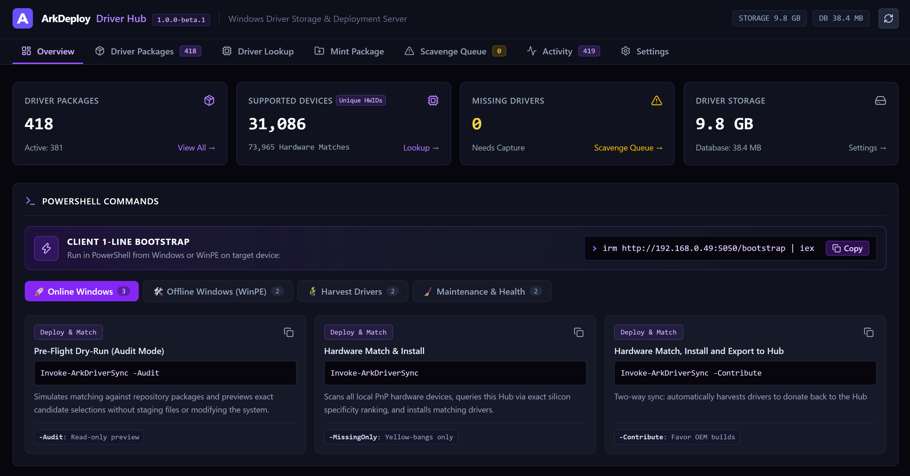
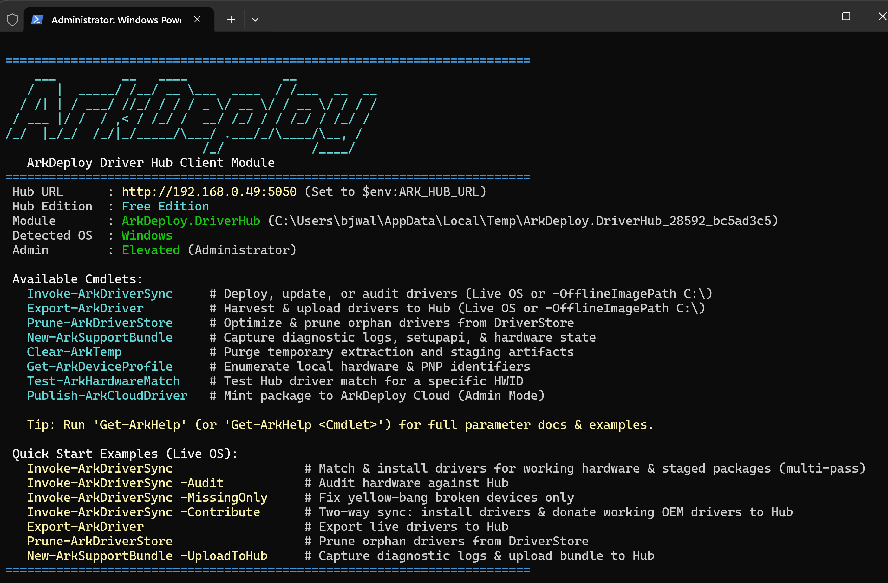
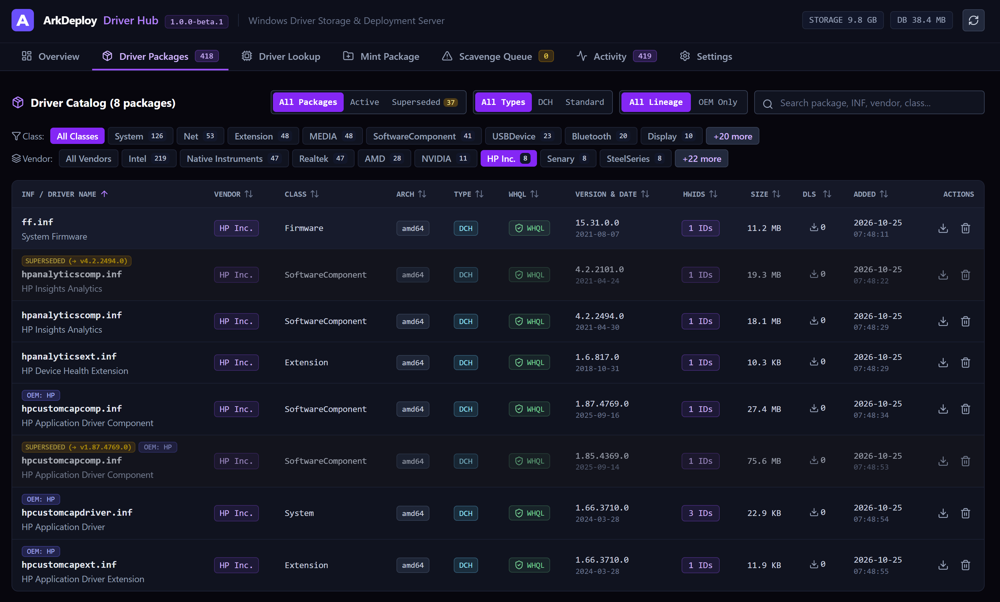

# ArkDeploy Driver Hub

[](https://github.com/ArkDeployDev/ArkDeploy.DriverHub/releases)
[](https://www.ArkDeploy.com)
[](https://www.ArkDeploy.com)
[](https://www.ArkDeploy.com)

**ArkDeploy Driver Hub** is a high-performance, on-premises driver management platform for IT teams and technicians. Build a central driver library, match drivers to hardware, and install or export them across Windows PCs and WinPE deployment environments. Native Win32 SetupAPI bus scans and content-addressable storage (CAS) deliver precise hardware matching in seconds, reducing reliance on bulky vendor driver packs.



*View your driver library, hardware coverage, and storage usage, with ready-to-copy commands for Windows and WinPE.*

---

## 📥 Downloads

**Current release: 1.0.1-beta.1 — Beta**

| Installer | Description | Version | Size | Direct Download |
| :--- | :--- | :---: | :---: | :---: |
| **ArkDeploy-DriverHub-Setup-v1.0.1-beta.1.exe** | Versioned Windows Installer | `1.0.1-beta.1` | ~13.4 MB | [⬇️ Download](https://github.com/ArkDeployDev/ArkDeploy.DriverHub/raw/main/releases/ArkDeploy-DriverHub-Setup-v1.0.1-beta.1.exe) |
| **ArkDeploy-DriverHub-Setup.exe** | Latest Release Pointer | Latest | ~13.4 MB | [⬇️ Download](https://github.com/ArkDeployDev/ArkDeploy.DriverHub/raw/main/releases/ArkDeploy-DriverHub-Setup.exe) |

### 🔒 Checksums (SHA-256)

| File | SHA-256 Checksum |
| :--- | :--- |
| `ArkDeploy-DriverHub-Setup-v1.0.1-beta.1.exe` | `a0a679d845316239bc889e07c87f20b1218b783c5694182397ba6a83c5695078` |
| `ArkDeploy-DriverHub-Setup.exe` | `a0a679d845316239bc889e07c87f20b1218b783c5694182397ba6a83c5695078` |

---

## 🚀 Installation

### Interactive Setup (GUI)

1. Download **ArkDeploy-DriverHub-Setup-v1.0.1-beta.1.exe**.
2. Run the executable as **Administrator**.
3. Choose your desired HTTP service port (default: `5050`).
4. Click **Install**. The installer automatically checks for .NET 10 runtime prerequisites (auto-downloading if missing), creates and starts the `ArkDeployHub` Windows Service, and adds the required Windows Firewall inbound rule.

### Unattended / Silent Installation

To deploy silently via script or automated provisioning:

```cmd
ArkDeploy-DriverHub-Setup-v1.0.1-beta.1.exe /VERYSILENT /SUPPRESSMSGBOXES /NORESTART
```

To specify a custom port during silent installation:

```cmd
ArkDeploy-DriverHub-Setup-v1.0.1-beta.1.exe /VERYSILENT /SUPPRESSMSGBOXES /NORESTART /PORT=8080
```

---

## 🖥️ Getting Started

### 1. Access the Hub Dashboard

Once installed, open your web browser and navigate to:

```text
http://localhost:5050
```

Or use `http://<your-server-ip>:5050` from another computer on your local network. If you selected a custom port, replace `5050` accordingly.

### 2. Connect a Windows PC or WinPE Session

On the client PC or in WinPE, open an elevated PowerShell prompt and run the following, replacing `<hub-ip>` with your Hub server’s IP address:

```powershell
irm http://<hub-ip>:5050/bootstrap | iex
```



*Commands for driver deployment, auditing, export, maintenance, and diagnostics, with built-in help and quick-start examples.*

### 3. Deploy, Match & Export Drivers

**Simulate & Audit — preview without installing:**

```powershell
Invoke-ArkDriverSync -Audit
```

**Match & Install Drivers:**

```powershell
Invoke-ArkDriverSync
```

**Export Drivers to the Hub:**

```powershell
Export-ArkDriver
```

**Match, Install & Contribute Drivers to the Hub:**

```powershell
Invoke-ArkDriverSync -Contribute
```

---

## 📦 Driver Library



*Browse and filter your driver library, inspect package details, and identify superseded versions and their replacements.*

---

## 🔎 Hardware Matching


*Inspect a hardware ID, compare ranked driver matches, and preview which base driver and companion extensions would be installed.*

---

## 📋 System Requirements

- **Operating System:** Windows 10 (1809+), Windows 11, or Windows Server 2016/2019/2022/2025 (64-bit).
- **Runtime:** Microsoft ASP.NET Core Runtime 10.0 (x64) (automatically installed by setup / WinGet).
- **Privileges:** Local Administrator rights required for service creation and driver injection.
- **Client Requirements:** Windows PowerShell 5.1 or PowerShell 7+ on target machines.

---

## 🌐 Official Resources

- **Website:** [ArkDeploy.com](https://www.ArkDeploy.com)
- **Documentation & Issues:** [ArkDeploy Driver Hub Issues](https://github.com/ArkDeployDev/ArkDeploy.DriverHub/issues)
